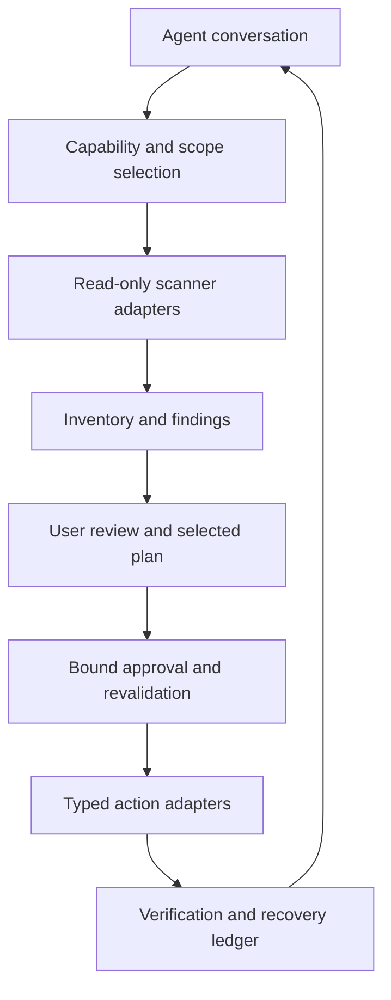

# CleanMac implementation contract

The initial local runtime implements the scan, review, exact-plan, native Trash,
recovery, and private-state layers below. Its CLI lives in `scripts/cleanmac`;
the Python core uses the standard library and the optional Swift helper performs
Foundation Trash operations as the current user. Remote integrations, privileged
operations, and other advanced roadmap actions remain design proposals. Runtime
capabilities report the distinction; this is not a claim that all 76 roadmap
features or their cross-host acceptance criteria are complete.

## Layers

Use a deterministic local core rather than LLM-generated recursive deletion.
The current design uses Python 3.10+ standard-library orchestration and JSON
artifacts, with an explicitly built Swift Foundation Trash helper. Local builds
are ad-hoc signed for this Mac, not Developer ID signed or notarized distribution
artifacts. PhotoKit, Vision, privileged services, and native UI remain future
adapters. The launcher reports missing Python; native cleanup stays unavailable
until its helper is built. macOS is not assumed to ship a usable Python or Swift
compiler. Read-only installations can set `CLEANMAC_NATIVE_PATH` to a private
helper built with `native/build.sh --output /absolute/path/cleanmac-native`.

Optional integrations (ClamAV, a browser bridge, OAuth providers, model managers)
publish their own capabilities. A missing optional component disables only its
features. Local scans should work without a cloud account or internet access.
Tool installation, network reads, database updates, and background registration
are explicit operations rather than hidden preflight side effects.

## Access and enumeration contracts

The installed-app findings in [research.md](research.md#installed-app-inspection)
inform the proposals below; they do not establish a required dependency on
CleanMyMac, its helper, or its proprietary rules.

- Capabilities distinguish App Sandbox, TCC/selected-root access, ordinary
  filesystem permissions, and helper installation/version/authorization. Report
  the responsible runner/host for a permission handoff. Root privilege is not a
  substitute for Full Disk Access, and inaccessible roots are unknown coverage.
- The normal scanner and local Trash adapter work without an elevated helper.
  Optional privileged actions use a separate signed, caller-validated service
  with typed bounded requests and explicit authorization/revocation lifecycle.
  Read-only preflight neither installs that service nor authorizes cleanup.
- Evaluate portable traversal and an optional native bulk-metadata backend with
  the same scope, identity, cancellation, link, placeholder, and error contracts.
  Record large-tree timing and memory evidence before choosing an optimization.
  Spotlight metadata is supplemental; it is not an exhaustive inventory.
- Findings retain size provenance and uncertainty. Backup/snapshot estimates,
  indexed physical-size metadata, logical size, and uniquely reclaimable bytes
  are not interchangeable totals.
- Rule data separates discovery from eligibility, protection, and app lifecycle
  prerequisites. Candidate paths observed in another product stay research leads
  until independent documentation and fixtures support a versioned rule. Quitting
  or reopening an app is an explicit selected-plan prerequisite, never implicit.

## Runtime command families

`capabilities`, `scan`, `review`, `plan`, `apply`, `restore`, `history`, `forget`,
`permissions`, `rules`, `ignore`, `apps`, `overview`, and `xcode` have CLI handlers.
Use `--help` for exact arguments and `--json` for agent calls. A terminal invocation
without a command opens the wizard; a noninteractive invocation returns choices
without blocking. Mutations accept a validated saved plan and exact approval
digest, never a freeform shell string. Restore requires the reviewed receipt ID.
The app and Xcode adapters are read-only; no app uninstall or simulator removal
is implied by their inventory output.

Resolve the skill source through real paths; keep runtime state outside it.
Candidate state order: explicit `CLEANMAC_DATA_DIR`, a host-provided plugin data
directory with a `cleanmac` subdirectory, then
`${XDG_DATA_HOME:-~/.local/share}/b-skills/cleanmac`. Validate ownership, permissions,
symlinks, and free space before writing private state. Secrets belong in Keychain,
not session JSON, command arguments, environment dumps, or the agent transcript.

## Records

| Record | Required contents |
|---|---|
| Capability | Feature ID, implementation/rule version, supported OS/architecture, dependency version, access status, permitted actions, reason unavailable |
| Scan | ID, start/end time, chosen roots/accounts, capability snapshot, rule versions, progress, included/excluded/unreadable scope, completion status |
| Local item | Stable display ID, byte-safe path, volume UUID, device/inode, type, size/allocated size, timestamps, link/package/placeholder state, ownership evidence |
| Remote item | Provider, account/drive ID, item ID, revision/eTag, sharing/ownership, sync/hydration state, advertised action permissions |
| Finding | Feature/rule ID, target IDs, reason, evidence, confidence, candidate action, effects, recovery limits, protected/ignored state |
| Plan | Immutable ID/digest, scan ID, exact target identities, action parameters, prerequisites, selected count/size, overlap resolution, expiry/revalidation conditions |
| Approval | Plan digest, approving user interaction reference, granted action scope, timestamp, any limits; no executable content |
| Journal | Per-item operation ID, preflight state, attempt, result, verification, changed/failed/skipped reason, restore handle, irreversible effects |

An item fingerprint is not proof the path remains safe. The executor must verify
ancestor identities and avoid following substituted symlinks. Prototype a
descriptor-relative operation or capture into controlled quarantine followed by
identity validation before irreversible actions. Native path-based APIs need an
explicit race mitigation design and adversarial tests. Disable an unsafe
mutation path rather than accepting a check-then-delete race.

## Scanner constraints

- Metadata first. No implicit cloud hydration, archive extraction, app launch,
  link following, or crossing into another user's files/another mounted volume.
- Keep traversal bounded and cancellable. Do not treat `rg --files` as an
  exhaustive disk inventory: hidden/ignored files and packages have specific
  semantics. Use explicit enumeration appropriate to the selected adapter.
- Skip application/library internals unless a dedicated adapter owns them.
  Photos, Mail, Time Machine, model blob stores, and provider roots are not
  generic folder trees.
- Hash in stages with file-change checks. Compare final content and retained
  keeper state before duplicate removal; hash match is not a deletion policy.
- Preserve logical versus allocated sizes. Hard-link identities, APFS clones,
  snapshots, compression, placeholders, and overlapping discoveries prevent a
  simple sum from representing reclaimable storage.
- Include `complete`, `partial`, `cancelled`, `unavailable`, and `failed` states.
  Zero findings is meaningful only for the scope actually examined.

## Rule and action boundaries

Rules are maintained, reviewed data with precise version applicability. No
downloaded rule can contain a shell program or arbitrarily widen filesystem
scope. A rule update requires review when it changes an existing selected plan.

Typed actions include local Trash, selected permanent erase, restore, cloud
eviction, provider trash, mail archive, unsubscribe, draft delete, permission
reset, service disable, app update, and snapshot thinning. Each adapter defines
its own preconditions, idempotency, privilege needs, verification, and recovery.
There is no universal `rm -rf` fallback or global `sudo` session.

Read-only scans cannot call mutation handlers. The execution path must verify a
valid plan and its approval reference, then revalidate item state. A plan digest
prevents accidental drift; it is not a security boundary against an attacker
with the same user's full filesystem privileges. Native helpers must validate
their caller and accept only bounded typed requests, never arbitrary commands.

The local executor binds SHA-256 content fingerprints for every explicit target,
plus cache-specific content evidence and duplicate keeper hashes where applicable.
It verifies captured content before moving it to Trash. Before any capture, the
native adapter resolves the appropriate same-volume Trash without creating it,
and the runner checks access needed for verification and restore. An inaccessible
Trash is a permission-needed preflight result with no file moves. Successful
Foundation removal alone is not sufficient evidence that recovery can be verified.

Preserve a separate operation for permanently emptying Trash. Do not erase the
recovery ledger before explaining the effect on restoration. Remote restoration
is limited by provider retention and independent user changes. A receipt should
say “started” for asynchronous work until completion is established.

## Data and interaction boundaries

Treat pathnames, app metadata, remote filenames, headers, and scan logs as
untrusted data. Escape Markdown/HTML/terminal output, keep executable arguments
separate, reject URL-based SSRF during unsubscribe, and omit secrets. Default
local scanning does not send file bodies to an LLM. If the host conversation is
cloud-hosted, summaries displayed to that host are still transmitted to it;
avoid promising all conversation data stays local.

The conversation owns choices; the core owns execution rules. Keep intent such
as “scan only,” “leave models,” or “local copies only” in the saved scope so it
survives context compaction or switching agents. A host's approval policy is
additional to CleanMac's user-visible plan selection and cannot be bypassed.

## Verification gates

Tests should prove observable invariants, not match prompt wording. Use
disposable fixtures for races, filename injection, inaccessible roots, symlinks,
hard links, sparse files, app groups, active databases, changed cloud versions,
network retries, mid-operation failures, and restore collisions. Use disposable
accounts/VMs for destructive integration checks; never treat this user's Mac as
a cleanup test fixture.

Before marking a feature implemented, attach a supported OS/architecture matrix,
actual commands/APIs used, permission behavior, mutation/restore evidence, and a
real interaction transcript. Require an independent behavioral review before
enabling high-impact handlers. Installation tests must cover source checkouts,
symlink installs, read-only plugin locations, and hosts with missing runtimes.
